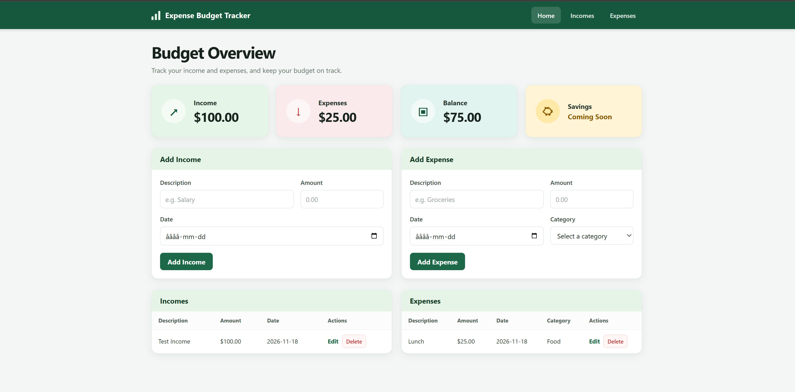

# 💰 Expense & Budget Tracker
### Personal Finance & Analytics Web Application

**Project Status:** ✅ Sprint 1 MVP Completed | **Development:** Sprint 2 Planned

---

## 📖 Project Overview

Expense & Budget Tracker is a personal finance web application designed to help users manage their income and expenses and understand their current financial balance.

The Sprint 1 MVP provides a working dashboard where users can add, edit, delete, and view financial records. The application automatically calculates total income, total expenses, and the remaining balance using data stored in PostgreSQL.

The application is built with Python, Flask, HTML, CSS, and PostgreSQL. It is containerized with Docker and deployed using Google Cloud Run and Cloud SQL.

Future development will include monthly budgets, fixed and recurring expenses, savings goals, and financial analytics.

---

## 🎯 Project Objectives

The main objectives are to:

- Provide a simple way to record and manage income and expenses.
- Store financial information in a PostgreSQL database.
- Automatically calculate total income, total expenses, and balance.
- Create a clear and user-friendly financial dashboard.
- Expand the application with budgeting, recurring expenses, savings, and analytics in Sprint 2.

---

## ✨ Sprint 1 MVP Features

### 💵 Income & Expense Management

- Add income and expense entries.
- Record amounts, descriptions, and dates.
- Organize expenses by category.
- Edit existing entries.
- Delete unwanted entries.
- View saved records in separate tables.
- Store financial records in PostgreSQL.

### 📊 Financial Dashboard

- Display total income.
- Display total expenses.
- Automatically calculate the remaining balance.
- Update totals when financial records change.
- Provide a responsive green-and-white dashboard.
- Display a Savings – Coming Soon card for future development.

**Note:** The Savings card is currently a visual placeholder. Savings tracking will be implemented in Sprint 2.

---

## 🛠️ Technology Stack

| Component | Technology | Purpose |
|---|---|---|
| Frontend | HTML, CSS, Jinja2 | Dashboard, forms, and tables |
| Backend | Python, Flask | Application logic and routes |
| Database | PostgreSQL | Store income and expense records |
| Database Driver | psycopg | Connect Flask to PostgreSQL |
| Containerization | Docker | Package and run the application |
| Version Control | Git, GitHub | Branches, commits, and pull requests |
| Cloud Deployment | Google Cloud Run | Host the application |
| Cloud Database | Google Cloud SQL | Host PostgreSQL |
| Project Management | Jira | Track stories, tasks, and sprint progress |
| Documentation | README, Confluence | Document technical and project work |
| AI Development Tools | GitHub Copilot, ChatGPT | Development and troubleshooting |

---

## 🏗️ Application Architecture

The application follows a frontend, backend, and database structure.

**Frontend (HTML, CSS, Jinja2)**  
Displays forms, financial records, and dashboard summaries.

⬇️

**Backend (Python / Flask)**  
Processes requests, validates input, performs CRUD operations, and calculates financial totals.

⬇️

**Database (PostgreSQL)**  
Stores income and expense records.

For the cloud deployment, Flask runs on Google Cloud Run and connects to PostgreSQL hosted in Google Cloud SQL.

---

## ⚙️ Installation & Local Setup

### Prerequisites

- Python 3.13
- PostgreSQL
- Git
- Docker (optional for container testing)

### 1. Clone the Repository

```bash
git clone https://github.com/annalena-project/expense-budget-tracker.git
cd expense-budget-tracker
```

### 2. Create a Virtual Environment

```bash
python -m venv .venv
```

Activate the virtual environment on Windows PowerShell:

```powershell
.\.venv\Scripts\Activate.ps1
```

### 3. Install Dependencies

```bash
pip install -r requirements.txt
```

### 4. Configure PostgreSQL

Create a local PostgreSQL database named:

```text
expense_budget_tracker
```

The application requires `income` and `expense` tables to store financial records.

The database must be initialized with the schema used by the Flask application before running it.

### 5. Configure Environment Variables

Create a `.env` file in the project directory.

```dotenv
DB_HOST=localhost
DB_PORT=5432
DB_NAME=expense_budget_tracker
DB_USER=postgres
DB_PASSWORD=your_local_database_password
```

Replace the placeholder password with your own PostgreSQL password.

**Security:** Never commit `.env` or real database credentials to GitHub.

### 6. Run the Application

```bash
python app.py
```

Open the application in your browser:

http://127.0.0.1:5000

---

## 🐳 Docker Containerization

The project includes a `Dockerfile` and `.dockerignore` to support containerized deployment.

Build the Docker image:

```bash
docker build -t expense-budget-tracker .
```

Run the container:

```bash
docker run --rm -p 8080:8080 --env-file .env -e DB_HOST=host.docker.internal expense-budget-tracker
```

Open the application at:

http://localhost:8080

The `host.docker.internal` setting allows the container to connect to PostgreSQL running on the host computer in a supported Docker Desktop environment.

The application has been successfully built and tested using Docker.

---

## ☁️ Google Cloud Deployment

The Sprint 1 MVP is deployed on Google Cloud Run with a PostgreSQL database hosted in Google Cloud SQL.

**Live Application:**

https://expense-budget-tracker-git-666317662633.us-central1.run.app

The cloud deployment has been tested with income and expense records.

The dashboard successfully displays financial totals using data stored in Cloud SQL.

The deployed application currently uses demonstration data.

---

## 🔧 Git & GitHub Workflow

The project uses Git and GitHub to track code changes and follow professional development practices.

Development activities include:

- Creating feature branches for new functionality.
- Writing descriptive commit messages.
- Pushing changes to GitHub.
- Creating and merging pull requests into `main`.
- Reviewing changes before merging.

Pull Request #6 integrated PostgreSQL, Docker configuration, and the Sprint 1 dashboard into the main branch.

**GitHub Repository:**

https://github.com/annalena-project/expense-budget-tracker

---

## 🚀 Agile Development Plan

The project follows an Agile development approach using Jira for planning and task management.

### 🟢 Sprint 1 – Minimum Viable Product (MVP)

**Target: End of Unit 12**

Completed features:

- Add income entries.
- Add expense entries.
- Edit existing financial records.
- Delete existing financial records.
- View saved income and expenses.
- Store financial information in PostgreSQL.
- Calculate total income, total expenses, and balance.
- Build a responsive financial dashboard.
- Containerize the application using Docker.
- Deploy the application to Google Cloud Run with Cloud SQL.
- Use Git feature branches, descriptive commits, and pull requests.

### 🔵 Sprint 2 – Final Application

**Target: End of Unit 14**

Planned features:

- Monthly budget planning and comparisons.
- Fixed and recurring expenses, such as rent, insurance, and subscriptions.
- Savings goals and contribution tracking.
- Expense analysis by category.
- Monthly spending trends.
- Income versus expense charts.
- Additional financial analytics.
- Further improvements to the application and development workflow.

The goal is to expand the Sprint 1 MVP into a more complete personal finance application.

---

## 🤖 AI-Assisted Development

AI tools were used throughout Sprint 1 to support learning, development, debugging, and documentation.

### GitHub Copilot

GitHub Copilot was used to:

- Assist with Flask and PostgreSQL integration.
- Support implementation of income and expense management.
- Help implement financial summary calculations.
- Create and refine the responsive dashboard design.
- Assist with debugging and code improvements.
- Support application testing.

### ChatGPT

ChatGPT was used to:

- Explain programming concepts and development tools.
- Help plan development steps.
- Support troubleshooting and problem-solving.
- Assist with PostgreSQL, Docker, Git, and Google Cloud configuration.
- Help prepare focused instructions for GitHub Copilot.
- Support documentation and project organization.

AI-generated suggestions were reviewed and tested during development.

The application was tested locally, using Docker, and after deployment to Google Cloud.

---

## 🧪 Testing & Verification

Sprint 1 testing included:

- Adding income and expense records.
- Verifying that records are stored in PostgreSQL.
- Testing edit and delete functionality during development.
- Checking financial summary calculations.
- Testing the dashboard layout on desktop and mobile screen sizes.
- Building and running the Docker container.
- Verifying that the deployed Google Cloud application connects to Cloud SQL.
- Confirming that saved financial records appear in the deployed dashboard.

---

## 📸 Application Screenshots

### Sprint 1 MVP Dashboard



---

## 📚 Project Documentation

Project planning and development documentation is maintained using:

- **Jira:** Epics, user stories, subtasks, acceptance criteria, and sprint progress.
- **Confluence:** Project overview, technical decisions, development challenges, and progress documentation.
- **GitHub:** Source code, commit history, pull requests, and technical documentation.

**Jira Project:**

https://annasch.atlassian.net/jira/software/projects/SCRUM/boards/1/backlog?epics=visible

**Confluence Space:**

https://annasch.atlassian.net/wiki/x/AYAG

---

## 📌 Current Project Status

✅ **Sprint 1 MVP implemented and deployed**

The application supports income and expense management with PostgreSQL storage, dynamic balance calculations, and a responsive dashboard.

The application is deployed to Google Cloud Run and connected to Cloud SQL.

Sprint 2 will focus on expanding the application with monthly budgets, fixed and recurring expenses, savings goals, and financial analytics.

---

## 🎓 Academic Project

This application is being developed as a final project for the **Modern Technologies** course at **North Park University, Chicago**.

**Project:** Expense & Budget Tracker  
**Project Type:** Personal Finance & Analytics Web Application
